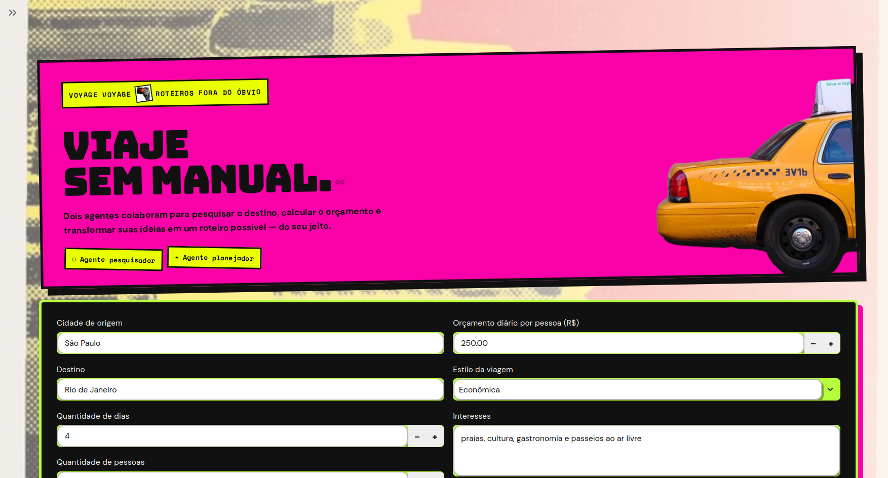

# Voyage Voyage



## Proposta

O **Voyage Voyage** é uma aplicação web de planejamento inteligente de
viagens. A pessoa informa a origem, o destino, a duração da viagem, o número
de viajantes, o orçamento, o estilo da viagem e seus interesses. A aplicação
usa essas informações para gerar um roteiro personalizado, organizado por
dia, com sugestões de atividades, deslocamentos e estimativas de custos.

O projeto foi desenvolvido para demonstrar a colaboração entre agentes
inteligentes em um problema prático. A interface é feita com Streamlit e pode
ser acessada diretamente pelo navegador após o deploy.

## Como funciona

O fluxo da aplicação é coordenado pelo LangGraph:

```text
Dados da viagem
      ↓
Agente Pesquisador
      ↓
Ferramenta de cálculo de orçamento
      ↓
Agente Planejador
      ↓
Roteiro personalizado
```

### Agente Pesquisador

Analisa o destino, a duração, o orçamento, o estilo e os interesses
informados. Ele reúne recomendações práticas e utiliza a ferramenta de
orçamento antes de encaminhar sua análise.

### Ferramenta de orçamento

A função `calcular_orcamento`, criada com `@tool`, estima o custo da viagem
considerando:

- quantidade de dias;
- custo diário por pessoa;
- quantidade de pessoas.

### Agente Planejador

Recebe a solicitação original e a análise do Agente Pesquisador. Em seguida,
transforma essas informações em um roteiro claro, dividido por dias e adaptado
às preferências da pessoa.

## Tecnologias

- Python;
- Streamlit;
- LangChain;
- LangGraph;
- Groq;
- modelo `openai/gpt-oss-120b`;
- ferramenta personalizada com `@tool`.

## Deploy

O projeto pode ser publicado gratuitamente no
[Streamlit Community Cloud](https://share.streamlit.io/). No deploy, o
arquivo principal é `app.py` e a chave da Groq deve ser cadastrada em
**App settings > Secrets**:

```toml
GROQ_API_KEY = "sua-chave-da-groq"
```

A chave não deve ser colocada no código nem enviada para o GitHub.

## Execução local opcional

Para clonar o projeto e executá-lo localmente, instale as dependências:

```bash
pip install -r requirements.txt
```

Depois, crie um arquivo `.env` a partir do modelo:

```bash
cp .env.example .env
```

Preencha o arquivo `.env` com sua chave pessoal:

```env
GROQ_API_KEY=sua-chave-da-groq
```

Por fim, inicie a aplicação:

```bash
streamlit run app.py
```

O arquivo `.env` é local e não deve ser commitado ou enviado para o GitHub.
